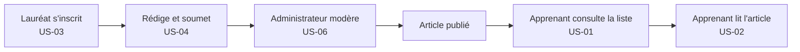

# Créer, estimer et ordonner le Product Backlog — Blog des Lauréats

> **Atelier** : Créer, estimer et ordonner le Product Backlog  
> **Unité d'apprentissage** : UA.351.11 — Initiation à la démarche Agile et cadre Scrum  
> **Projet** : Blog des Lauréats — Solicode Tanger  
> **Apprenant** : Marwan bouhamid  
> **Encadrant** : ESSARRAJ Fouad  
> **Product Owner désigné dans le dépôt** : Groupe 1 (`docs/cadrage/note-cadrage.md`)  
> **Date** : 26 novembre 2026  
> **Version** : 1.0

---

## 1. Contexte de l'atelier

Cet atelier prolonge l'atelier **Vision Produit et User Stories** du même projet. Il ne reprend pas l'exemple générique de la TodoList : il part des cinq User Stories déjà formalisées dans `tutoriels/scrum/initiation-scrum/vision-besoins/vision-besoins.md`, du cadrage du dépôt et des fonctionnalités documentées dans le rapport.

L'objectif est de transformer ces besoins en un **Product Backlog ordonné**, d'estimer l'effort relatif en **Story Points** sur l'échelle de Fibonacci, d'appliquer la priorisation **MoSCoW**, puis de formaliser une **Definition of Ready (DoR)** et une **Definition of Done (DoD)**.

Le document distingue systématiquement :

| Statut | Signification |
|---|---|
| **Reprise** | User Story déjà validée dans l'atelier Vision/Besoins, reprise sans modification de fond. |
| **Proposition** | User Story ou règle déduite de documents du dépôt (cas d'utilisation, note de cadrage, diagramme de classes), mais non encore validée par le Product Owner. |
| **Hypothèse** | Interprétation de travail explicitement signalée, à confirmer. |

> **Limite méthodologique majeure** : aucune session d'estimation d'équipe (planning poker), aucune vélocité et aucun historique de sprints terminés ne sont disponibles dans le dépôt. Les Story Points proposés ici sont donc des **estimations initiales raisonnées**, pas des mesures ni un consensus d'équipe.

---

## 2. Introduction

Un Product Backlog n'est pas une simple liste de tâches. C'est un **outil de décision** : il rend visibles les besoins, leur valeur, leur coût relatif et leur ordre de traitement. Il permet au Product Owner de répondre à une question simple mais difficile : *que doit construire l'équipe en premier pour maximiser la valeur du produit ?*

Pour le Blog des Lauréats, cette question se pose concrètement. Le produit doit permettre à un lauréat de publier un témoignage, à un administrateur de le valider, et à un apprenant de le lire. Toutes les fonctionnalités ne contribuent pas également à cette boucle. Certaines la rendent possible, d'autres l'améliorent, d'autres encore peuvent attendre.

Ce document répond à quatre besoins :

1. **Comprendre** le rôle du Product Backlog et du Product Owner.
2. **Estimer** au moins cinq User Stories en Story Points, avec une justification par story.
3. **Ordonner et prioriser** le backlog avec MoSCoW, en isolant le MVP de la sélection d'un sprint.
4. **Contractualiser la qualité** avec une DoR et une DoD vérifiables.

---

## 3. Contexte projet : Blog des Lauréats

### 3.1 Le produit

Le Blog des Lauréats est une application web communautaire destinée à **Solicode Tanger**. Les lauréats y rédigent et publient des articles retraçant leur parcours professionnel ; les apprenants actuels les consultent pour découvrir des trajectoires concrètes.

| Élément | Description | Source |
|---|---|---|
| **Produit** | Plateforme web de publication et de consultation d'articles | `README.md` |
| **Public** | Lauréats de Solicode Tanger, apprenants actuels, visiteurs | `README.md`, `docs/cadrage/note-cadrage.md` |
| **Problème** | Témoignages utiles mais dispersés, peu structurés et difficiles à retrouver | `docs/cadrage/note-cadrage.md` |
| **Promesse** | Centraliser et valoriser les parcours sous forme d'articles lisibles et modérés | Vision Produit (atelier précédent) |
| **Stack** | Laravel, MySQL, Blade, Tailwind CSS, Preline UI, Alpine.js | `README.md`, `docs/cadrage/stack-technique.md` |
| **Architecture** | Contrôleur mince → classe Service → modèles Eloquent | `README.md`, `rapport/chapitres/17 - Réalisation.md` |

### 3.2 Acteurs retenus

| Acteur | Rôle | Source |
|---|---|---|
| **Lauréat contributeur** | Rédige, soumet et suit ses propres articles | Diagramme de cas d'utilisation, note de cadrage |
| **Apprenant / visiteur** | Consulte la liste et lit les articles publiés | Diagramme de cas d'utilisation, note de cadrage |
| **Administrateur** | Modère les articles et gère les catégories | Diagramme de cas d'utilisation, note de cadrage |

### 3.3 État réel du dépôt

| Constat | Conséquence pour cet atelier |
|---|---|
| Le code source Laravel n'est **pas présent** dans ce dépôt. | L'état d'implémentation n'est pas vérifiable ici ; seule la documentation fait foi. |
| Le dossier `issues/` est **absent**, alors que le README et `sprints/sprints.md` le mentionnent. | Aucun backlog existant à réutiliser ; le présent document devient la proposition de référence. |
| `sprints/sprints.md` documente un **Sprint 1 actif** : initialisation, cadrage et consultation détaillée d'un article. | La User Story US-02 est documentée comme livrée ; les autres restent à faire. |
| Le dépôt est actuellement sur la branche `sprint0`, alors que la documentation déclare `sprint1` active. | Incohérence à vérifier avant toute planification. |
| Les chapitres 5, 9, 14, 16 et 18 du rapport sont des **titres vides**. | Aucun contenu n'en est extrait. |
| Aucun entretien, questionnaire ou statistique d'usage n'existe. | Les personas et les priorités restent des hypothèses de travail. |

---

## 4. Product Backlog : définition et rôle

### 4.1 Qu'est-ce qu'un Product Backlog ?

Le **Product Backlog** est la liste ordonnée et évolutive de tout ce qui est nécessaire pour améliorer le produit. Il contient des User Stories, mais aussi des éléments techniques, des corrections, des dettes et des risques. C'est la **source unique de vérité** des changements à apporter au produit.

Trois propriétés le caractérisent :

- **Ordonné** : les éléments les plus importants sont en haut, pour que l'équipe sache quoi faire ensuite.
- **Émergent** : il n'est jamais figé ; il s'enrichit et se réordonne à mesure que l'on apprend.
- **Sous responsabilité du Product Owner** : c'est lui qui arbitre le contenu et l'ordre.

### 4.2 À quoi sert-il dans Scrum ?

| Usage | Effet concret sur le projet |
|---|---|
| **Transparence** | Chacun voit les besoins, leur valeur et leur avancement. |
| **Priorisation** | Le PO décide ce qui entre dans le MVP et ce qui attend. |
| **Planification** | Le Sprint Planning sélectionne les éléments prêts du haut du backlog. |
| **Adaptation** | Les retours de Sprint Review modifient l'ordre et le contenu. |
| **Traçabilité** | Chaque story peut être reliée à la vision, à un acteur et à des critères d'acceptation. |

### 4.3 Pourquoi est-il raffiné en continu ?

Le backlog est **raffiné** (ou *groomé*) régulièrement, pas seulement avant un sprint. Quatre raisons justifient cette pratique :

1. **Réduire l'incertitude** : une story floue devient plus précise après discussion.
2. **Découper** : un élément estimé à 8 SP ou plus est scindé en stories plus petites.
3. **Ré-estimer** : une nouvelle information technique change l'effort relatif.
4. **Garder le haut du backlog prêt** : l'équipe ne doit pas attendre pour démarrer.

Pour le Blog des Lauréats, le raffinement est particulièrement nécessaire sur deux points : le statut intermédiaire « en attente de publication » (non présent dans le diagramme de classes) et l'attribution du rôle administrateur (non documentée).

### 4.4 Que doit contenir chaque élément du backlog ?

| Champ | Rôle | Exemple (US-02) |
|---|---|---|
| **ID** | Identifiant stable et traçable | `US-02` |
| **Titre** | Résumé lisible en une ligne | Lire le détail d'un article |
| **Type** | User Story, tâche technique, bug, dette | User Story |
| **Énoncé** | Format « En tant que… je veux… afin de… » | Voir section 6 |
| **Valeur métier** | Bénéfice attendu pour l'utilisateur ou le produit | Cœur de la promesse produit |
| **Critères d'acceptation** | Conditions observables et testables | Voir section 6 |
| **Estimation** | Effort relatif en Story Points | 5 SP |
| **Priorité** | Catégorie MoSCoW | Must Have |
| **Dépendances** | Stories ou ressources nécessaires | Aucune (story autonome) |
| **Origine / preuve** | Document du dépôt justifiant la story | Atelier Vision/Besoins, `sprints/sprints.md` |
| **Statut de préparation** | Prête, à raffiner, à valider | Reprise |

### 4.5 Responsabilité du Product Owner

Le dépôt désigne le **Groupe 1** comme Product Owner et lui confie trois missions : recueillir les besoins, définir les priorités et valider les fonctionnalités (`docs/cadrage/note-cadrage.md`). Le cadre Scrum y ajoute les responsabilités suivantes :

- **Posséder et ordonner le backlog** : le PO est accountable de son contenu et de son ordre.
- **Maximiser la valeur** : chaque décision d'ordre doit servir la valeur produit, pas la facilité technique.
- **Exprimer les éléments** : rendre les besoins compréhensibles par l'équipe.
- **Arbitrer le périmètre** : décider ce qui entre dans le MVP et ce qui est reporté.
- **Valider la readiness** : confirmer qu'une story est prête avant le sprint.
- **Ne pas imposer la solution technique** : le « comment » appartient aux Developers ; l'estimation leur revient.

> **Nuance importante** : dans ce projet individuel, l'apprenant joue à la fois le rôle de développeur et celui d'analyste. Les décisions de priorisation doivent donc être explicitement validées par le Product Owner désigné (Groupe 1) ou par l'encadrant. Le présent document ne remplace pas cette validation.

### 4.6 Comment User Stories, valeur, estimation et priorité s'articulent

Ces quatre notions sont complémentaires et ne se substituent pas l'une à l'autre :

| Notion | Question à laquelle elle répond | Erreur à éviter |
|---|---|---|
| **User Story** | Quel besoin, pour quel utilisateur ? | Décrire une tâche technique (« créer une table SQL »). |
| **Valeur métier** | Pourquoi ce besoin compte-t-il ? | Confondre valeur et facilité de développement. |
| **Estimation** | Quel effort relatif ? | Convertir les Story Points en heures. |
| **Priorité** | Dans quel ordre le traiter ? | Trier automatiquement par coût croissant. |

**Exemple concret dans le projet** : US-04 (rédiger et soumettre un article) est estimée à **8 SP**, l'élément le plus coûteux du backlog. Elle reste pourtant **Must Have** et placée haut, car sans elle le blog ne se renouvelle pas. À l'inverse, US-08 (gérer les catégories) est estimée à **3 SP**, mais classée **Could Have** : un référentiel initial suffit au lancement. La priorité suit la valeur et les dépendances, pas la taille.

### 4.7 Product Backlog et Sprint Backlog

| Critère | Product Backlog | Sprint Backlog |
|---|---|---|
| **Propriétaire** | Product Owner | Developers (avec l'objectif du sprint) |
| **Horizon** | Tout le produit, sans limite de durée | Un seul sprint |
| **Contenu** | Tous les besoins, y compris futurs et différés | Éléments sélectionnés + plan de réalisation |
| **Granularité** | Variable : grossière en bas, fine en haut | Fine, découpée en tâches |
| **Évolution** | Continu, à chaque raffinement | Figé pendant le sprint, ajusté seulement par l'équipe |
| **Engagement associé** | **Product Goal** | **Sprint Goal** |
| **Exemple Blog des Lauréats** | US-01 à US-10, dont US-09 et US-10 hors périmètre actuel | US-02 + US-01 proposées pour le Sprint 1 (8 SP) |

Le Product Backlog dit **quoi** et **pourquoi** ; le Sprint Backlog dit **ce qui est fait maintenant** et **comment**. Le second est un sous-ensemble du premier, jamais l'inverse.

---

## 5. Story Points et estimation Fibonacci

### 5.1 Pourquoi des Story Points plutôt que des heures ?

Les Story Points mesurent un **effort relatif**, pas une durée. Une estimation en heures suppose que l'on connaît à l'avance la solution, les interruptions et la disponibilité. Ce n'est pas le cas ici : le code n'est pas dans le dépôt, l'équipe n'a pas d'historique de vélocité et plusieurs règles métier restent à valider.

Les Story Points intègrent quatre dimensions :

| Dimension | Exemple sur le projet |
|---|---|
| **Complexité technique** | Authentification, rôles et autorisations (US-03). |
| **Volume de travail** | Formulaire de rédaction, validation et workflow de statuts (US-04). |
| **Incertitude** | Statut « en attente de publication » non documenté dans le diagramme de classes. |
| **Risque** | Sécurité des accès, intégrité des données, régression sur la page article. |

> **Règle absolue** : aucun Story Point n'est converti en heures, en jours ou en nombre de développeurs. Une story à 8 SP n'est pas « deux fois plus longue » qu'une story à 4 SP : elle est *plus grande et plus incertaine*.

### 5.2 L'échelle de Fibonacci retenue

L'atelier impose l'échelle **1, 2, 3, 5, 8** :

| Valeur | Signification relative | Exemple de story |
|---|---|---|
| **1** | Très petite, quasi certaine | Correction d'un libellé, ajustement de style mineur. |
| **2** | Petite, bien comprise | Ajout d'un champ d'affichage simple. |
| **3** | Modérée, périmètre clair | Liste en lecture seule avec état vide (US-01, US-05, US-08). |
| **5** | Moyenne, règles ou sécurité impliquées | Page détail avec 404 (US-02), authentification (US-03), modération (US-06). |
| **8** | Grande, plusieurs règles et forte incertitude | Rédaction + brouillon + soumission + autorisation (US-04). |

Les écarts entre les valeurs forcent la discussion : si une story hésite entre 3 et 5, l'équipe doit expliciter ce qui la rend plus complexe. La valeur **8** sert de **seuil d'alerte** : au-delà, la story doit être découpée avant d'entrer dans un sprint.

### 5.3 Story de référence et processus d'estimation proposé

Pour donner un point d'ancrage, **US-02 (lire le détail d'un article) est utilisée comme story de référence à 5 SP** : elle implique une route, un contrôleur, un service, une vue Blade, une gestion de 404 et un affichage responsive.

Processus proposé, à adopter par l'équipe :

1. Le PO lit la story et ses critères d'acceptation.
2. Les Developers posent leurs questions et identifient les risques.
3. Chacun estime en silence, puis les écarts sont discutés.
4. L'équipe converge vers une valeur de l'échelle.
5. La justification est consignée dans le backlog.

> **Statut de ces estimations** : propositions initiales de l'analyste, fondées sur la complexité documentée. Elles ne constituent **ni une mesure, ni un consensus d'équipe, ni un engagement de délai**.

---

## 6. Estimation des User Stories

**Dix User Stories** sont analysées : les cinq de l'atelier Vision/Besoins (reprises) et cinq propositions adossées au diagramme de cas d'utilisation, à la note de cadrage et au diagramme de classes.

### 6.1 US-01 — Consulter la liste des articles publiés

| Champ | Valeur |
|---|---|
| **ID** | US-01 |
| **Titre** | Consulter la liste des articles publiés |
| **Acteur** | Apprenant / visiteur (persona Salma) |
| **Origine** | Reprise — atelier Vision/Besoins |
| **Priorité MoSCoW** | **Must Have** |
| **Estimation** | **3 Story Points** |

**User Story** : *En tant qu'apprenante, je veux consulter la liste des articles publiés afin de découvrir les parcours des lauréats et choisir ceux qui m'intéressent.*

**Valeur métier** : la liste est le point d'entrée du blog. Sans elle, les articles existent mais restent introuvables.

**Justification de l'estimation (3 SP)** : lecture seule, une requête filtrée sur le statut « publié », une route, un contrôleur mince, une vue Blade et un état vide. Aucune règle métier complexe, aucune authentification. La valeur 3 reflète un périmètre clair mais non trivial (filtrage, affichage de quatre informations par article, lien vers le détail).

**Complexité et incertitude** :
- Complexité faible à modérée.
- Incertitude : le tri et la pagination ne sont pas spécifiés dans le dépôt. Ils ne doivent pas être ajoutés sans validation.

**Critères d'acceptation** :
- **Étant donné** des articles publiés et des articles en brouillon, **quand** j'ouvre la page de liste, **alors** seuls les articles publiés sont affichés, avec leur titre, leur auteur, leur catégorie et leur date de publication.
- **Étant donné** la liste affichée, **quand** je sélectionne un article, **alors** je suis dirigé vers la page de détail correspondante.
- **Étant donné** qu'aucun article n'est publié, **quand** j'ouvre la liste, **alors** un message explicite indique qu'aucun article n'est disponible.

---

### 6.2 US-02 — Lire le détail d'un article

| Champ | Valeur |
|---|---|
| **ID** | US-02 |
| **Titre** | Lire le détail d'un article |
| **Acteur** | Apprenant / visiteur (persona Salma) |
| **Origine** | Reprise — atelier Vision/Besoins ; documentée comme livrée au Sprint 1 |
| **Priorité MoSCoW** | **Must Have** |
| **Estimation** | **5 Story Points** (story de référence) |

**User Story** : *En tant qu'apprenante, je veux lire le détail d'un article afin de comprendre le parcours et les conseils d'un lauréat.*

**Valeur métier** : c'est le cœur de la promesse produit. L'article est le contenu qui transmet l'expérience et crée l'utilité pour l'apprenante.

**Justification de l'estimation (5 SP)** : la story combine une route à paramètre (`/articles/{slug}`), un contrôleur, une classe Service, une vue Blade responsive, l'affichage de cinq informations et la gestion sémantique de l'erreur 404. Elle est plus lourde que la liste (3 SP) mais reste bien délimitée. La valeur 5 est cohérente avec la story de référence.

**Complexité et incertitude** :
- Complexité moyenne : routage par slug, distinction « inexistant » / « non publié », responsive.
- Incertitude réduite : le comportement est documenté dans `rapport/chapitres/17 - Réalisation.md` et `sprints/sprints.md`.
- **Réserve** : le code n'étant pas dans ce dépôt, l'état « livré » n'est pas vérifiable ; l'estimation porte sur le périmètre complet, pas sur un reste à faire mesuré.

**Critères d'acceptation** :
- **Étant donné** un article publié identifié par son slug, **quand** j'ouvre l'URL `/articles/{slug}`, **alors** le titre, le contenu, l'auteur, la catégorie et la date de publication sont affichés.
- **Étant donné** un slug inexistant ou un article non publié, **quand** j'ouvre son URL, **alors** une page d'erreur 404 est affichée et aucun contenu de l'article n'est révélé.
- **Étant donné** un écran mobile ou de bureau, **quand** je lis l'article, **alors** le contenu reste lisible sans défilement horizontal.

---

### 6.3 US-03 — Créer un compte et se connecter

| Champ | Valeur |
|---|---|
| **ID** | US-03 |
| **Titre** | Créer un compte et se connecter |
| **Acteur** | Lauréat contributeur (persona Yassine) |
| **Origine** | Reprise — atelier Vision/Besoins |
| **Priorité MoSCoW** | **Must Have** (story habilitante) |
| **Estimation** | **5 Story Points** |

**User Story** : *En tant que lauréat, je veux créer un compte et me connecter afin d'accéder à mon espace de rédaction.*

**Valeur métier** : l'authentification protège l'identité des auteurs et conditionne toute contribution. Elle ne crée pas de valeur seule, mais elle rend la production de contenu possible.

**Justification de l'estimation (5 SP)** : inscription, connexion, hachage du mot de passe, validation des champs, gestion de session, attribution du rôle « lauréat », protection des routes et redirection des visiteurs non authentifiés. La sécurité et les cas d'erreur justifient la valeur 5 plutôt que 3.

**Complexité et incertitude** :
- Complexité moyenne à élevée : sécurité, sessions, rôles, redirections.
- Incertitude : le mécanisme exact d'authentification n'est pas spécifié (solution native Laravel ou starter kit). Ce choix appartient aux Developers.
- Dépendance : aucune dépendance fonctionnelle, mais prérequis de US-04 et US-05.

**Critères d'acceptation** :
- **Étant donné** un visiteur sur le formulaire d'inscription, **quand** il saisit un nom, un courriel et un mot de passe valides, **alors** un compte avec le rôle « lauréat » est créé et il est authentifié.
- **Étant donné** un compte existant, **quand** les identifiants saisis sont incorrects, **alors** l'accès est refusé et un message d'erreur explicite est affiché.
- **Étant donné** un visiteur non authentifié, **quand** il tente d'accéder à l'espace de rédaction, **alors** il est redirigé vers la page de connexion.

---

### 6.4 US-04 — Rédiger et soumettre un article

| Champ | Valeur |
|---|---|
| **ID** | US-04 |
| **Titre** | Rédiger et soumettre un article |
| **Acteur** | Lauréat contributeur (persona Yassine) |
| **Origine** | Reprise — atelier Vision/Besoins |
| **Priorité MoSCoW** | **Must Have** |
| **Estimation** | **8 Story Points** |

**User Story** : *En tant que lauréat, je veux rédiger un article, l'enregistrer en brouillon puis le soumettre afin de partager mon parcours professionnel.*

**Valeur métier** : c'est la fonctionnalité qui alimente le blog et garantit sa durabilité. Sans contribution, le contenu ne se renouvelle pas et la communauté perd l'intérêt du produit.

**Justification de l'estimation (8 SP)** : story la plus lourde du backlog. Elle cumule un formulaire complet, une validation serveur, la création et la mise à jour d'un article, la gestion du statut brouillon, la transition vers « en attente de publication », le contrôle de propriété (un lauréat ne modifie que ses articles) et le rattachement à une catégorie. Plusieurs règles métier se combinent : c'est précisément le cas typique d'une story à 8 SP.

**Complexité et incertitude** :
- Complexité élevée : workflow de statuts, autorisation, validation, intégrité des données.
- Incertitude : le statut « en attente de publication » est proposé par l'atelier Vision/Besoins mais absent du diagramme de classes (qui mentionne brouillon et publié). Le type d'éditeur (texte simple ou éditeur enrichi) n'est pas spécifié.
- Dépendance : US-03 (authentification) et référentiel de catégories.

**Critères d'acceptation** :
- **Étant donné** un lauréat authentifié, **quand** il renseigne un titre, un contenu et une catégorie puis enregistre un brouillon, **alors** l'article est enregistré au statut « brouillon » et n'est visible que dans son espace personnel.
- **Étant donné** un brouillon complet, **quand** le lauréat le soumet, **alors** son statut passe à « en attente de publication » et il n'apparaît pas dans la liste publique.
- **Étant donné** un champ obligatoire manquant, **quand** le lauréat tente d'enregistrer ou de soumettre, **alors** des messages de validation s'affichent et aucun enregistrement incomplet n'est créé.

---

### 6.5 US-05 — Suivre le statut de mes articles

| Champ | Valeur |
|---|---|
| **ID** | US-05 |
| **Titre** | Suivre le statut de mes articles |
| **Acteur** | Lauréat contributeur (persona Yassine) |
| **Origine** | Reprise — atelier Vision/Besoins |
| **Priorité MoSCoW** | **Should Have** |
| **Estimation** | **3 Story Points** |

**User Story** : *En tant que lauréat, je veux suivre le statut de mes articles afin de savoir s'ils sont en brouillon, en attente de publication ou publiés.*

**Valeur métier** : la transparence sur l'état de publication réduit l'incertitude du contributeur et l'encourage à publier à nouveau.

**Justification de l'estimation (3 SP)** : page de liste personnelle en lecture seule, filtrée sur l'auteur authentifié, avec affichage du statut et de la date de publication. La complexité est faible, mais la story dépend de trois autres (US-03, US-04, US-06) pour produire des statuts réels.

**Complexité et incertitude** :
- Complexité faible : requête filtrée par auteur + affichage.
- Incertitude : la liste exacte des statuts dépend de la validation du workflow de modération.
- Dépendances : US-03, US-04, US-06.

**Critères d'acceptation** :
- **Étant donné** un lauréat authentifié possédant plusieurs articles, **quand** il ouvre son espace personnel, **alors** chaque article affiche son titre, son statut et, s'il est publié, sa date de publication.
- **Étant donné** un article en attente de publication, **quand** l'administrateur le publie, **alors** son statut devient « publié » et il apparaît dans la liste publique.
- **Étant donné** un article encore en brouillon, **quand** un visiteur ouvre la liste publique, **alors** cet article n'y figure pas.

---

### 6.6 US-06 — Modérer et publier les articles

| Champ | Valeur |
|---|---|
| **ID** | US-06 |
| **Titre** | Modérer et publier les articles |
| **Acteur** | Administrateur |
| **Origine** | **Proposition** — cas d'utilisation « Modérer les articles », « Publier ou dépublier », note de cadrage ; support indispensable du MVP selon l'atelier Vision/Besoins |
| **Priorité MoSCoW** | **Must Have** |
| **Estimation** | **5 Story Points** |

**User Story** : *En tant qu'administrateur, je veux modérer les articles soumis et les publier ou les dépublier afin de garantir la qualité et la conformité des contenus publiés.*

**Valeur métier** : sans modération, aucun article soumis ne devient public. La modération est la condition de la qualité éditoriale et de la crédibilité du blog.

**Justification de l'estimation (5 SP)** : file de modération, affichage des articles en attente, action de publication et de dépublication, mise à jour de la date de publication, contrôle d'accès par rôle et protection de la route. Le volume est modéré, mais les transitions de statut et l'autorisation justifient 5 SP.

**Complexité et incertitude** :
- Complexité moyenne : autorisation par rôle, transitions de statut, cohérence de la liste publique.
- Incertitude : l'attribution du rôle administrateur n'est pas documentée (compte créé manuellement, seed, invitation ?). Le statut « en attente » doit être validé.
- Dépendance : US-04.

**Critères d'acceptation** :
- **Étant donné** un article au statut « en attente de publication », **quand** l'administrateur ouvre la file de modération, **alors** l'article apparaît avec son titre, son auteur, sa catégorie et sa date de soumission.
- **Étant donné** un article en attente, **quand** l'administrateur le publie, **alors** son statut devient « publié », sa date de publication est renseignée et il apparaît dans la liste publique.
- **Étant donné** un article publié, **quand** l'administrateur le dépublie, **alors** il disparaît de la liste publique et son statut repasse à « brouillon ».
- **Étant donné** un lauréat authentifié sans rôle administrateur, **quand** il tente d'accéder à la modération, **alors** l'accès est refusé.

---

### 6.7 US-07 — Rechercher et filtrer les articles

| Champ | Valeur |
|---|---|
| **ID** | US-07 |
| **Titre** | Rechercher et filtrer les articles |
| **Acteur** | Apprenant / visiteur (persona Salma) |
| **Origine** | **Proposition** — note de cadrage (« consultation et recherche des articles », « filtrage par catégories »), reportée hors MVP par l'atelier Vision/Besoins |
| **Priorité MoSCoW** | **Could Have** |
| **Estimation** | **5 Story Points** |

**User Story** : *En tant qu'apprenante, je veux rechercher un article par mot-clé et filtrer la liste par catégorie afin de trouver rapidement un témoignage proche de mon parcours.*

**Valeur métier** : améliore la découverte lorsque le volume d'articles augmente. Non nécessaire au lancement, où une liste courte reste exploitable.

**Justification de l'estimation (5 SP)** : deux mécanismes à combiner (recherche textuelle et filtre par catégorie), gestion des paramètres d'URL, interface de filtrage, requêtes conditionnelles et tests des combinaisons. La valeur 5 reflète cette combinaison, pas la difficulté intrinsèque de chaque filtre.

**Complexité et incertitude** :
- Complexité moyenne : requêtes combinées, état de l'interface, performance.
- Incertitude : les champs réellement recherchés (titre seul ou titre + contenu) ne sont pas spécifiés.
- Dépendance : US-01 et US-08 (référentiel de catégories).

**Critères d'acceptation** :
- **Étant donné** des articles publiés, **quand** je saisis un mot-clé présent dans un titre, **alors** seuls les articles publiés correspondants sont affichés.
- **Étant donné** une catégorie sélectionnée, **quand** j'applique le filtre, **alors** seuls les articles publiés de cette catégorie sont affichés.
- **Étant donné** une combinaison sans résultat, **quand** je lance la recherche, **alors** un message explicite propose de modifier les critères.
- **Étant donné** des articles en brouillon, **quand** j'utilise la recherche, **alors** ils n'apparaissent jamais dans les résultats.

---

### 6.8 US-08 — Gérer les catégories

| Champ | Valeur |
|---|---|
| **ID** | US-08 |
| **Titre** | Gérer les catégories |
| **Acteur** | Administrateur |
| **Origine** | **Proposition** — cas d'utilisation « Gérer les catégories », diagramme de classes (entité `Categorie`) |
| **Priorité MoSCoW** | **Could Have** |
| **Estimation** | **3 Story Points** |

**User Story** : *En tant qu'administrateur, je veux gérer les catégories afin de maintenir un classement cohérent des articles.*

**Valeur métier** : garantit la cohérence du classement thématique. Un référentiel initial préparé suffit pour la première version.

**Justification de l'estimation (3 SP)** : opérations CRUD simples sur une entité à deux champs utiles (nom, slug), avec contrôle d'unicité et autorisation administrateur. Pas de règle métier complexe, d'où 3 SP.

**Complexité et incertitude** :
- Complexité faible : CRUD standard.
- Incertitude : la règle de suppression d'une catégorie contenant des articles n'est pas documentée. Une règle est proposée ci-dessous et doit être validée.
- Dépendance : aucune pour le CRUD, mais US-04 utilise le référentiel.

**Critères d'acceptation** :
- **Étant donné** un administrateur authentifié, **quand** il crée une catégorie avec un nom unique, **alors** la catégorie est enregistrée et disponible pour les articles.
- **Étant donné** une catégorie existante, **quand** l'administrateur la renomme, **alors** les articles rattachés conservent leur classement.
- **Étant donné** une catégorie contenant des articles, **quand** l'administrateur tente de la supprimer, **alors** la suppression est refusée avec un message explicite *(règle proposée, à valider)*.
- **Étant donné** un lauréat sans rôle administrateur, **quand** il tente de gérer les catégories, **alors** l'accès est refusé.

---

### 6.9 US-09 — Modifier ou supprimer un article

| Champ | Valeur |
|---|---|
| **ID** | US-09 |
| **Titre** | Modifier ou supprimer un article |
| **Acteur** | Lauréat contributeur |
| **Origine** | **Proposition** — cas d'utilisation « Modifier un article », « Supprimer un article » ; reportée par l'atelier Vision/Besoins |
| **Priorité MoSCoW** | **Won't Have (this time)** |
| **Estimation** | **5 Story Points** |

**User Story** : *En tant que lauréat, je veux modifier ou supprimer mes articles afin de corriger un contenu obsolète ou une erreur.*

**Valeur métier** : permet de maintenir les contenus à jour. Utile, mais non bloquant pour une première mise en ligne : le brouillon peut être corrigé avant soumission.

**Justification de l'estimation (5 SP)** : réutilisation partielle du formulaire de US-04, mais ajout du contrôle de propriété, de la gestion du slug, d'une confirmation de suppression et du comportement à appliquer à un article déjà publié. La valeur 5 est **indicative** : la story est hors périmètre actuel et n'a pas été affinée.

**Complexité et incertitude** :
- Complexité moyenne : autorisation, intégrité du slug, suppression.
- Incertitude : le comportement attendu après modification d'un article publié (repasser en modération ou rester publié) n'est pas documenté.
- Dépendance : US-03, US-04.

**Critères d'acceptation** :
- **Étant donné** un lauréat authentifié, **quand** il modifie son propre brouillon, **alors** les changements sont enregistrés et restent invisibles publiquement.
- **Étant donné** un lauréat authentifié, **quand** il supprime son propre brouillon après confirmation, **alors** l'article disparaît de son espace personnel.
- **Étant donné** un article appartenant à un autre lauréat, **quand** un lauréat tente de le modifier ou de le supprimer, **alors** l'accès est refusé.

---

### 6.10 US-10 — Consulter le profil public d'un lauréat

| Champ | Valeur |
|---|---|
| **ID** | US-10 |
| **Titre** | Consulter le profil public d'un lauréat |
| **Acteur** | Apprenant / visiteur |
| **Origine** | **Proposition** — note de cadrage (« consultation des profils des lauréats »), attribut `bio` du diagramme de classes ; reportée par l'atelier Vision/Besoins |
| **Priorité MoSCoW** | **Won't Have (this time)** |
| **Estimation** | **5 Story Points** |

**User Story** : *En tant qu'apprenante, je veux consulter le profil public d'un lauréat afin de mieux situer son parcours et ses réalisations.*

**Valeur métier** : enrichit la valorisation des parcours. L'article affiche déjà le nom de l'auteur, ce qui suffit à la première version.

**Justification de l'estimation (5 SP)** : page de profil, récupération du lauréat et de ses articles publiés, gestion du 404, mise en page responsive et décision sur les champs publics. La valeur 5 est **indicative** : story non affinée, hors périmètre actuel.

**Complexité et incertitude** :
- Complexité moyenne : jointure profil/articles, 404, affichage.
- Incertitude : les champs du profil réellement publics ne sont pas définis (le diagramme de classes mentionne `bio`, mais pas de photo ni de liens).
- Dépendance : US-01, US-02.

**Critères d'acceptation** :
- **Étant donné** un lauréat existant, **quand** j'ouvre son profil public, **alors** son nom, sa biographie et la liste de ses articles publiés sont affichés.
- **Étant donné** un lauréat ayant des brouillons, **quand** j'ouvre son profil, **alors** seuls ses articles publiés apparaissent.
- **Étant donné** un identifiant de lauréat inexistant, **quand** j'ouvre l'URL, **alors** une page 404 est affichée.

---

### 6.11 Synthèse des estimations

| ID | User Story | Origine | SP | MoSCoW |
|---|---|---|---|---|
| US-01 | Consulter la liste des articles publiés | Reprise | 3 | Must |
| US-02 | Lire le détail d'un article | Reprise | 5 | Must |
| US-03 | Créer un compte et se connecter | Reprise | 5 | Must |
| US-04 | Rédiger et soumettre un article | Reprise | 8 | Must |
| US-05 | Suivre le statut de mes articles | Reprise | 3 | Should |
| US-06 | Modérer et publier les articles | Proposition | 5 | Must |
| US-07 | Rechercher et filtrer les articles | Proposition | 5 | Could |
| US-08 | Gérer les catégories | Proposition | 3 | Could |
| US-09 | Modifier ou supprimer un article | Proposition | 5 | Won't |
| US-10 | Consulter le profil public d'un lauréat | Proposition | 5 | Won't |
| | **Total (y compris les éléments différés)** | | **47** | |

> Le total de 47 SP n'est **pas** une prévision de durée. Il exprime uniquement la taille relative cumulée du backlog analysé.

Aucune story n'est estimée à 1 ou 2 SP : chaque besoin documenté implique un parcours complet (route, contrôleur, service, vue et règle métier), jamais un simple ajustement isolé. Les valeurs 1 et 2 restent disponibles dans l'échelle pour de futurs éléments plus petits.

---

## 7. Product Backlog ordonné

### 7.1 Principe d'ordonnancement

Le backlog n'est **pas trié par Story Points**. Il est ordonné selon trois critères, dans cet ordre :

1. **Valeur métier** : ce qui ferme la boucle de valeur du produit passe en premier.
2. **Dépendances** : une story qui en rend une autre possible doit précéder celle-ci.
3. **Préparation** : une story déjà engagée et bien documentée remonte.

### 7.2 Backlog ordonné

| Rang | ID | User Story | Valeur métier | SP | MoSCoW | Justification de l'ordre |
|---|---|---|---|---|---|---|
| 1 | US-02 | Lire le détail d'un article | Élevée — cœur de la promesse | 5 | Must | Contenu central du produit ; story déjà engagée et documentée au Sprint 1, donc la plus prête. |
| 2 | US-01 | Consulter la liste des articles publiés | Élevée — point d'entrée | 3 | Must | Rend l'article découvrable ; aucune dépendance, readiness immédiate. |
| 3 | US-03 | Créer un compte et se connecter | Élevée — habilitante | 5 | Must | Conditionne toute contribution ; prérequis direct de US-04 et US-05. |
| 4 | US-04 | Rédiger et soumettre un article | Élevée — alimente le blog | 8 | Must | Sans contribution, le blog s'épuise ; dépend de US-03. |
| 5 | US-06 | Modérer et publier les articles | Élevée — rend le contenu public | 5 | Must | Ferme la boucle : sans modération, aucun article soumis ne devient public ; dépend de US-04. |
| 6 | US-05 | Suivre le statut de mes articles | Moyenne — transparence | 3 | Should | Confort du contributeur, non bloquant ; dépend de US-03, US-04 et US-06. |
| 7 | US-07 | Rechercher et filtrer les articles | Moyenne — découvrabilité | 5 | Could | Devient utile avec le volume ; la liste initiale suffit au lancement. |
| 8 | US-08 | Gérer les catégories | Moyenne — cohérence | 3 | Could | Un référentiel initial suffit ; le CRUD complet peut attendre. |
| 9 | US-09 | Modifier ou supprimer un article | Moyenne — maintenance | 5 | Won't | Reporté : le brouillon peut être corrigé avant soumission. |
| 10 | US-10 | Consulter le profil public d'un lauréat | Moyenne — valorisation | 5 | Won't | Reporté : l'auteur est déjà visible dans l'article. |

### 7.3 Pourquoi cet ordre ?

- **Les deux premières places** sont occupées par la lecture et la liste : ce sont les deux faces de la promesse publique. L'article est le contenu, la liste le rend accessible. Les placer en tête garantit qu'un visiteur obtient de la valeur même sans compte.
- **US-03 arrive ensuite** parce qu'elle est habilitante : elle ne crée pas de valeur seule, mais sans elle US-04 et US-05 sont impossibles.
- **US-04 puis US-06** respectent une dépendance stricte : on ne modère que ce qui a été soumis. Les inverser produirait une file de modération vide.
- **US-05 descend en sixième position** : elle améliore l'expérience du contributeur, mais le parcours de valeur fonctionne sans elle. C'est la seule divergence assumée avec la liste du MVP de l'atelier précédent (voir section 15).
- **US-07 et US-08** sont utiles mais conditionnées par le volume et par un référentiel initial.
- **US-09 et US-10** sont explicitement hors périmètre actuel : les placer en bas rend visible qu'elles ne sont pas oubliées, seulement différées.

---

## 8. Priorisation MoSCoW

### 8.1 Principe

| Catégorie | Signification | Conséquence |
|---|---|---|
| **Must Have** | Indispensable au produit initial utilisable. | Sans elle, le MVP n'a pas de sens. |
| **Should Have** | Importante, mais peut être reportée sans empêcher la valeur initiale. | Prévue après le socle. |
| **Could Have** | Amélioration utile, non essentielle. | Traitée si le contexte le permet. |
| **Won't Have (this time)** | Explicitement exclue du périmètre actuel. | Pourra être reconsidérée plus tard. |

### 8.2 Must Have — 26 SP

| ID | User Story | SP | Pourquoi Must |
|---|---|---|---|
| US-01 | Consulter la liste des articles publiés | 3 | Point d'entrée : sans liste, le contenu n'est pas découvrable. |
| US-02 | Lire le détail d'un article | 5 | Cœur de la valeur : c'est l'article qui transmet le témoignage. |
| US-03 | Créer un compte et se connecter | 5 | Rend la contribution possible et protège l'identité des auteurs. |
| US-04 | Rédiger et soumettre un article | 8 | Alimente le blog et garantit sa durabilité. |
| US-06 | Modérer et publier les articles | 5 | Sans publication contrôlée, aucun article soumis ne devient public. |

**Total Must : 26 SP.** Ces cinq stories forment le **MVP** (section 9).

### 8.3 Should Have — 3 SP

| ID | User Story | SP | Pourquoi Should |
|---|---|---|---|
| US-05 | Suivre le statut de mes articles | 3 | Améliore nettement l'expérience du contributeur, mais le parcours de valeur fonctionne sans elle : le lauréat peut constater la publication en consultant la liste publique. |

### 8.4 Could Have — 8 SP

| ID | User Story | SP | Pourquoi Could |
|---|---|---|---|
| US-07 | Rechercher et filtrer les articles | 5 | Utile lorsque le volume augmente ; une liste courte reste exploitable au lancement. |
| US-08 | Gérer les catégories | 3 | Un référentiel initial suffit ; le CRUD complet est un confort d'administration. |

### 8.5 Won't Have (this time) — 10 SP indicatifs

| ID | User Story | SP | Pourquoi Won't |
|---|---|---|---|
| US-09 | Modifier ou supprimer un article | 5 | Le brouillon peut être corrigé avant soumission ; le workflow complet de modification est différé. |
| US-10 | Consulter le profil public d'un lauréat | 5 | L'auteur est déjà affiché dans l'article ; la page profil est un enrichissement futur. |

**Éléments explicitement hors périmètre du produit** (et non de simples reports) :

- messagerie instantanée ;
- paiement et abonnements en ligne ;
- réseau social complexe ;
- recommandations par intelligence artificielle ;
- synchronisation avec des plateformes externes ;
- application mobile native (contradiction documentaire à arbitrer, voir section 15).

> **Distinction essentielle** : « Won't Have (this time) » signifie *exclu de la version actuelle*, pas *abandonné définitivement*. Les éléments hors périmètre, eux, sortent du produit sauf décision contraire du Product Owner.

### 8.6 Répartition

| Catégorie | Stories | Story Points |
|---|---|---|
| Must Have | 5 | 26 |
| Should Have | 1 | 3 |
| Could Have | 2 | 8 |
| Won't Have (this time) | 2 | 10 (indicatif) |
| **Total** | **10** | **47** |

---

## 9. Périmètre MVP

### 9.1 Définition retenue

Le MVP est la plus petite version du Blog des Lauréats qui **ferme la boucle de valeur** : un lauréat s'inscrit, rédige et soumet un article ; un administrateur le publie ; un apprenant le découvre et le lit.

Cette définition reprend celle de l'atelier Vision/Besoins. Une fonctionnalité n'est pas Must parce qu'elle existe déjà ou parce qu'elle est facile à coder, mais parce que la boucle ne fonctionne pas sans elle.

> **Application stricte** : US-02 est classée Must parce que sans la page article, la promesse de transmettre un témoignage n'existe pas — **pas** parce qu'elle est documentée comme déjà livrée. À l'inverse, US-08 (3 SP) reste Could malgré sa faible taille, car un référentiel initial suffit au lancement.

### 9.2 Contenu du MVP

| # | Fonctionnalité | User Story | SP | Rôle dans la boucle |
|---|---|---|---|---|
| 1 | Inscription et connexion | US-03 | 5 | Ouvrir l'accès à la contribution. |
| 2 | Rédaction, brouillon et soumission | US-04 | 8 | Produire le contenu. |
| 3 | Modération et publication | US-06 | 5 | Transformer une soumission en contenu public. |
| 4 | Liste des articles publiés | US-01 | 3 | Rendre le contenu découvrable. |
| 5 | Lecture du détail et 404 | US-02 | 5 | Délivrer la valeur finale. |
| | **Total MVP** | | **26** | |

### 9.3 Ce qui n'est pas dans le MVP

- **US-05 (suivi du statut)** : confort du contributeur, non bloquant.
- **US-07 (recherche et filtres)** : inutile à faible volume.
- **US-08 (gestion des catégories)** : un référentiel initial suffit.
- **US-09 et US-10** : reportés.
- **Toutes les fonctionnalités hors périmètre** listées en 8.5.

> **À valider par le Product Owner** : la frontière exacte du MVP. La proposition ci-dessus est argumentée, mais aucune décision formelle du Groupe 1 n'est enregistrée dans le dépôt.

---

## 10. Proposition de sélection Sprint 1

### 10.1 Ce que documente déjà le dépôt

`sprints/sprints.md` déclare un **Sprint 1 actif** intitulé « Initialisation, Cadrage & Première Fonctionnalité Laravel ». Son objectif pédagogique inclut l'initialisation du dépôt, l'outillage, le cadrage, la modélisation et **la consultation détaillée d'un article** avec gabarit Blade responsive et gestion 404. La User Story US-02 y est donc documentée comme livrée.

Ces tâches d'initialisation et de cadrage ne sont pas des User Stories : elles ne sont **pas estimées en Story Points** dans ce document.

### 10.2 Sélection proposée

| Élément | SP | Statut | Justification |
|---|---|---|---|
| **US-02** — Lire le détail d'un article | 5 | Documenté comme livré au Sprint 1 | Cœur de la valeur ; périmètre complet (route, 404, responsive). |
| **US-01** — Consulter la liste des articles publiés | 3 | **Proposé** | Point d'entrée naturel, aucune dépendance d'authentification, readiness élevée. |
| **Total fonctionnel proposé** | **8** | Proposition, non engagement | |

### 10.3 Pourquoi cette sélection ?

- **US-02 est déjà engagée** : la maintenir dans le périmètre du Sprint 1 assure la continuité avec la documentation existante.
- **US-01 ne dépend de rien** : elle peut être développée sans attendre l'authentification, contrairement à US-03, US-04 et US-06.
- **La paire liste + détail** forme un incrément démontrable : un visiteur peut découvrir et lire un article, ce qui constitue une valeur testable en Sprint Review.
- **Les stories de contribution sont écartées** : US-03, US-04 et US-06 forment une chaîne lourde (18 SP) dont la readiness dépend de décisions non tranchées (statut « en attente », rôle administrateur).

### 10.4 Limites explicites de cette proposition

- **Aucune capacité d'équipe n'est supposée.** Le total de 8 SP est un périmètre proposé, pas un engagement : il ne dit rien du temps nécessaire.
- **Aucune vélocité n'est inventée.** Le dépôt ne contient aucun sprint terminé permettant de calibrer l'équipe.
- **Si le Product Owner maintient le Sprint 1 dans son périmètre strictement documenté**, la sélection fonctionnelle se réduit à **US-02 (5 SP)** et US-01 devient la première candidate du sprint suivant.
- **US-02 est documentée comme livrée, mais le code est absent du dépôt** : la revue de sprint doit vérifier l'incrément réel avant de le considérer comme terminé.

> **MVP ≠ Sprint 1** : le MVP compte cinq stories (26 SP) ; le Sprint 1 n'en propose que deux (8 SP). Un sprint ne doit pas être dimensionné pour absorber tout le MVP.

---

## 11. Definition of Ready (DoR)

### 11.1 Objet

La DoR est un **accord d'entrée** : elle vérifie qu'une User Story est suffisamment claire, estimée et préparée pour être engagée dans un sprint. Une story qui échoue à la DoR retourne au raffinement ; elle n'entre pas dans le Sprint Backlog.

> **Statut** : proposition de DoR, à adopter formellement par l'équipe et le Product Owner. Aucune DoR validée n'existe dans le dépôt.

### 11.2 Checklist

| # | Critère | Condition vérifiable | Comment l'équipe vérifie |
|---|---|---|---|
| 1 | **Format respecté** | L'énoncé contient les trois clauses « En tant que… je veux… afin de… » et un acteur identifié. | Lecture en refinement ; l'acteur correspond à un acteur du diagramme de cas d'utilisation. |
| 2 | **Besoin et valeur explicites** | Une phrase de valeur métier relie la story à la vision produit. | Le PO reformule la valeur sans relire la story ; si c'est impossible, la story n'est pas prête. |
| 3 | **Critères d'acceptation testables** | Au moins deux critères au format Étant donné / Quand / Alors, chacun avec un résultat observable. | Un Developer peut écrire un test directement à partir du critère, sans question supplémentaire. |
| 4 | **Périmètre délimité** | La story indique ce qu'elle inclut et ce qu'elle exclut. | Comparaison avec la colonne « Origine » et les stories voisines pour détecter les chevauchements. |
| 5 | **Dépendances identifiées** | Les stories ou ressources nécessaires sont listées, et aucune n'est non livrée et bloquante. | Vérification de la colonne « Dépendances » et de l'ordre du backlog. |
| 6 | **Estimation réalisée** | Une valeur de l'échelle 1, 2, 3, 5, 8 est attribuée par l'équipe. | Séance d'estimation ; consensus consigné ; aucune valeur hors échelle. |
| 7 | **Priorité établie** | Une catégorie MoSCoW est renseignée par le PO. | Lecture du backlog ; la story figure dans une seule catégorie. |
| 8 | **Taille compatible avec un sprint** | La story est estimée à 8 SP au maximum. | Si 8 SP est dépassé ou contesté, découpage avant engagement. |
| 9 | **Informations et ressources disponibles** | Routes, modèles, maquettes, règles métier et jeu de données nécessaires sont accessibles. | Vérification dans le dépôt et dans la documentation ; liste des manques consignée. |
| 10 | **Contraintes non fonctionnelles connues** | Les exigences de sécurité, de responsive et d'accessibilité applicables sont identifiées. | Référence à `docs/cadrage/stack-technique.md` et à la note de cadrage (WCAG 2.2). |
| 11 | **Validation du Product Owner** | Le PO a explicitement marqué la story comme « Prête ». | Case « Prête » cochée dans le backlog, avec date et auteur de la validation. |

### 11.3 Ce que la DoR n'est pas

- Ce n'est pas une garantie de succès : elle réduit l'ambiguïté, elle ne supprime pas les risques.
- Ce n'est pas une barrière définitive : une story peut être re-raffinée et revenir.
- Ce n'est pas un document figé : elle s'ajuste après chaque rétrospective.

---

## 12. Definition of Done (DoD)

### 12.1 Objet

La DoD est un **accord de sortie** : elle définit ce que signifie « terminé » pour l'incrément. Une story qui ne satisfait pas la DoD n'est pas comptée comme terminée, même si du code a été écrit.

> **Statut** : proposition de DoD, à adopter formellement par l'équipe. Le dépôt mentionne une méthodologie TDD et des tests automatisés, mais aucune DoD officielle n'y est enregistrée.

### 12.2 Checklist

| # | Critère | Condition vérifiable | Comment l'équipe vérifie |
|---|---|---|---|
| 1 | **Critères d'acceptation satisfaits** | Chaque critère de la story est démontré et passe. | Démonstration en Sprint Review + tests nommés d'après les critères. |
| 2 | **Tests automatisés au vert** | La suite de tests du projet passe sans échec. | Exécution de la suite PHPUnit/Pest documentée dans la stack ; aucune régression. |
| 3 | **Architecture respectée** | Contrôleur mince, logique métier dans une classe Service, modèles Eloquent pour l'accès aux données. | Revue de code : aucune requête métier directement dans la vue ni dans le contrôleur. |
| 4 | **Sécurité assurée** | Authentification et autorisation vérifiées, validation serveur, protection CSRF, échappement XSS, requêtes paramétrées. | Revue de code + tests des accès refusés ; contrôle des middlewares. |
| 5 | **Interface responsive** | Affichage correct sur mobile, tablette et bureau, sans défilement horizontal. | Test manuel aux largeurs définies + vérification du gabarit Blade. |
| 6 | **Accessibilité de base** | Navigation au clavier, contrastes suffisants, HTML sémantique. | Vérification selon les critères WCAG 2.2 cités dans la note de cadrage. |
| 7 | **Cas d'erreur gérés** | Les cas 404, accès refusé et validation échouée produisent un comportement explicite. | Tests dédiés et vérification manuelle des messages. |
| 8 | **Aucun bug bloquant ou critique** | Aucun défaut de sévérité bloquante ou critique n'est ouvert sur la story. | Revue de la liste des anomalies avant clôture. |
| 9 | **Code relu** | La modification a été relue selon le processus convenu. | Revue par un pair ou par le formateur avant fusion *(processus à confirmer)*. |
| 10 | **Documentation à jour** | README, documentation ou rapport mis à jour si le comportement, le modèle ou les routes changent. | Comparaison du diff avec la documentation concernée. |
| 11 | **Intégration sur la branche du sprint** | La modification est fusionnée sur la branche `sprintN` et l'application démarre. | Vérification de la branche, démarrage local, parcours de la fonctionnalité. |
| 12 | **Base de données à jour** | Si le modèle change, les migrations sont versionnées et rejouables. | Exécution des migrations sur une base de test. |

### 12.3 Ce que la DoD n'est pas

- Ce n'est pas « le code est écrit » : c'est « le code est intégré, testé, relu et utilisable ».
- Ce n'est pas une liste de tâches : c'est un **standard de qualité** partagé.
- Ce n'est pas négociable story par story : elle s'applique à toutes les stories de l'incrément.

---

## 13. DoR et DoD : complémentarité

### 13.1 Tableau comparatif

| Definition of Ready | Definition of Done |
|---|---|
| Avant le développement | Après le développement |
| Vérifie qu'une story est prête à être engagée | Vérifie que le travail achevé respecte les standards de qualité |
| Porte sur la clarté et la préparation | Porte sur l'implémentation et la qualité |
| Utilisée lors du raffinement et du Sprint Planning | Utilisée pendant le sprint et à la Sprint Review |
| Une story non prête retourne au backlog | Une story non terminée retourne au Sprint Backlog |
| Réduit le risque de malentendu | Réduit le risque de livrer un incrément incomplet |
| Responsabilité principale : Product Owner (avec l'équipe) | Responsabilité principale : Developers |

### 13.2 Rôles complémentaires

La DoR et la DoD encadrent le travail à ses deux extrémités :

- **La DoR protège l'entrée** : elle empêche de démarrer une story ambiguë, non estimée ou dépendante d'un élément absent. Elle évite les allers-retours coûteux en cours de sprint.
- **La DoD protège la sortie** : elle empêche de déclarer « terminé » un travail non testé, non relu ou non intégré. Elle garantit que l'incrément est réellement utilisable.

Utilisées ensemble, elles créent un **cycle vertueux** : une story bien préparée (DoR) a plus de chances d'atteindre la qualité attendue (DoD), et les enseignements de la DoD nourrissent le raffinement suivant.

**Exemple sur le projet** : US-06 (modération) ne peut pas entrer en sprint tant que le rôle administrateur et le statut « en attente » ne sont pas tranchés (DoR). Une fois développée, elle ne peut être déclarée terminée que si les accès non autorisés sont testés, la dépublication vérifiée et la liste publique cohérente (DoD).

---

## 14. Conclusion

Ce document transforme cinq User Stories validées et cinq propositions documentées en un **Product Backlog ordonné de dix éléments**, estimé à **47 Story Points** sur l'échelle de Fibonacci 1–2–3–5–8.

Les points structurants sont les suivants :

- **Le MVP est resserré à cinq stories (26 SP)** : liste, lecture, authentification, rédaction/soumission et modération. Il ferme la boucle de valeur, de l'inscription à la lecture.
- **Le Sprint 1 proposé est distinct du MVP** : deux stories (US-02 et US-01, 8 SP), choisies pour leur readiness et l'absence de dépendance à l'authentification.
- **La priorisation suit la valeur et les dépendances**, jamais la taille : US-04 (8 SP) est Must, US-08 (3 SP) est Could.
- **La DoR et la DoD sont formalisées avec des critères vérifiables**, mais restent des propositions à adopter par l'équipe.

Les limites sont assumées : aucune session d'estimation d'équipe, aucune vélocité, aucun code applicatif dans le dépôt. Les estimations sont des propositions raisonnées, pas des mesures. Les décisions de périmètre appartiennent au Product Owner.

---

## 15. Sources, preuves, hypothèses et points à valider

### 15.1 Documents inspectés

| Source | Informations utilisées |
|---|---|
| `README.md` | Description du projet, publics, stack, architecture 2 couches, organisation des dossiers. |
| `docs/cadrage/note-cadrage.md` | Contexte, objectif SMART, périmètre In/Out, parties prenantes, Product Owner (Groupe 1), contraintes, risques. |
| `docs/cadrage/stack-technique.md` | Exigences de sécurité, responsive, accessibilité, tests automatisés, NativePHP. |
| `sprints/sprints.md` | Sprint 1 actif, objectif, travaux réalisés, branche `sprint1`. |
| `sprints/readme.md` | Règles de gouvernance des sprints, source de vérité. |
| `tutoriels/scrum/initiation-scrum/vision-besoins/vision-besoins.md` | Vision, personas, cinq User Stories, critères d'acceptation, MVP, évolutions futures. |
| `tutoriels/scrum/initiation-scrum/vision-besoins/presentation-vision-besoins.md` | Synthèse et conventions de présentation Marp. |
| `tutoriels/scrum/initiation-scrum/comprendre-scrum/presentation-agile-scrum.md` | Définitions Scrum, artefacts, DoD, conventions Marp et notes orateur. |
| `rapport/chapitres/7 - Méthode SCRUM.md` | Organisation en sprints, objectif du Sprint 1. |
| `rapport/chapitres/13 - Diagramme de cas d'utilisation.md` | Acteurs et cas d'utilisation (consulter, lire, rédiger, publier/dépublier, modifier, supprimer, gérer les catégories, modérer). |
| `rapport/chapitres/15 - Diagramme de classes.md` | Entités `Laureat`, `Article`, `Categorie` ; statuts brouillon/publié ; attribut `bio`. |
| `rapport/chapitres/17 - Réalisation.md` | Route `/articles/{slug}`, gestion 404, architecture MVC et 3-tiers. |
| `presentations/presentation.md`, `presentations/presentation-sprint-1.md` | Métadonnées du projet (apprenant, encadrant, établissement). |
| `rapport/chapitres/5, 9, 14, 16, 18` | **Titres vides** : aucun contenu utilisé. |
| Historique Git | Branches `sprint0`, `sprint1`, `main` ; absence de code applicatif et de dossier `issues/`. |

### 15.2 Faits vérifiés

- Le produit, ses acteurs et sa promesse sont documentés.
- Cinq User Stories avec critères d'acceptation existent déjà.
- Le Sprint 1 est documenté comme actif et US-02 comme livrée.
- L'architecture cible est un contrôleur mince déléguant à une classe Service.
- Les exigences de sécurité, de responsive et d'accessibilité sont explicites.
- Le Product Owner est désigné comme « Groupe 1 ».

### 15.3 Interprétations et hypothèses

| Élément | Nature | À valider |
|---|---|---|
| Découpage de US-06, US-07, US-08, US-09, US-10 | Proposition déduite des cas d'utilisation et de la note de cadrage | Oui — le PO doit confirmer leur formulation et leur existence dans le backlog. |
| US-05 classée **Should** alors que l'atelier Vision/Besoins l'incluait dans le MVP | Divergence assumée : la story est décrite comme « non bloquante pour une première mise en ligne » | Oui — arbitrage du PO. |
| Estimations en Story Points | Propositions initiales raisonnées, sans session d'équipe | Oui — à confirmer par planning poker. |
| Statut « en attente de publication » | Proposé par l'atelier Vision/Besoins, absent du diagramme de classes | Oui — décision de modélisation. |
| Rôle administrateur | Existe dans les cas d'utilisation, mais son attribution n'est pas documentée | Oui — définir le mode de création du compte. |
| Règle de suppression d'une catégorie non vide | Proposition de règle métier | Oui — validation fonctionnelle. |
| Ordre du backlog | Proposition argumentée, non validée | Oui — validation du PO. |
| DoR et DoD | Propositions, non adoptées formellement | Oui — adoption en équipe. |

### 15.4 Informations manquantes

- Code source Laravel : absent du dépôt, donc l'état réel d'implémentation n'est pas vérifiable.
- Dossier `issues/` : mentionné mais absent, donc aucun backlog existant à réutiliser.
- Entretiens, questionnaires ou statistiques d'usage.
- Vélocité, historique de sprints terminés, capacité de l'équipe.
- Session d'estimation collective (planning poker).
- Validation formelle du MVP, des priorités et des statuts par le Product Owner.

### 15.5 Points de contradiction à arbitrer

| Point | Contradiction | Décision attendue |
|---|---|---|
| **Mobile natif** | La note de cadrage exclut les applications natives ; la stack technique prévoit NativePHP pour Android. | Product Owner / encadrant. |
| **Version de Laravel** | Le README mentionne Laravel 12 ; le chapitre « Réalisation » mentionne Laravel 13. | Équipe technique. |
| **Branche active** | `sprints/sprints.md` déclare `sprint1` active ; le dépôt est sur `sprint0`. | Vérification avant planification. |
| **Périmètre de la recherche** | La note de cadrage l'inclut dans le In-Scope ; l'atelier Vision/Besoins la reporte hors MVP. | Product Owner : In-Scope ≠ version actuelle, mais la formulation doit être clarifiée. |
| **US-05 dans le MVP** | L'atelier Vision/Besoins l'inclut ; sa propre justification la décrit comme non bloquante. | Product Owner. |

> **Conclusion sur la fiabilité** : les éléments factuels de ce document sont adossés aux fichiers du dépôt. Les estimations, l'ordre, les propositions de stories et les contrats DoR/DoD sont des propositions de travail explicitement signalées ; ils ne doivent pas être présentés comme des décisions validées par l'équipe ou le Product Owner.
